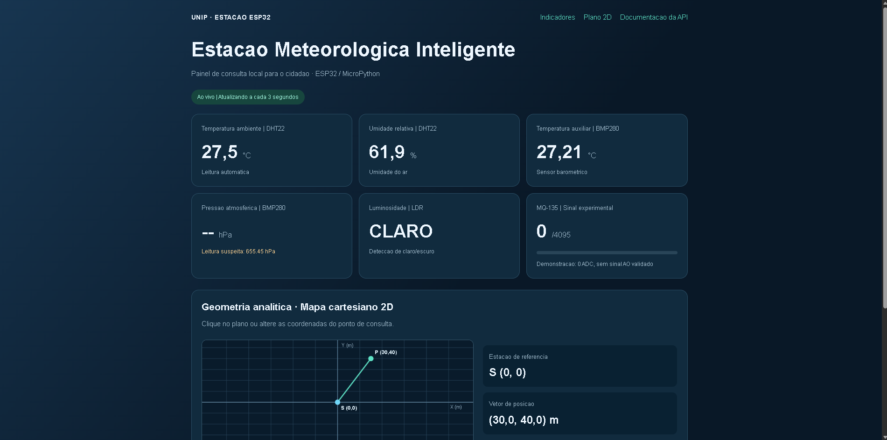
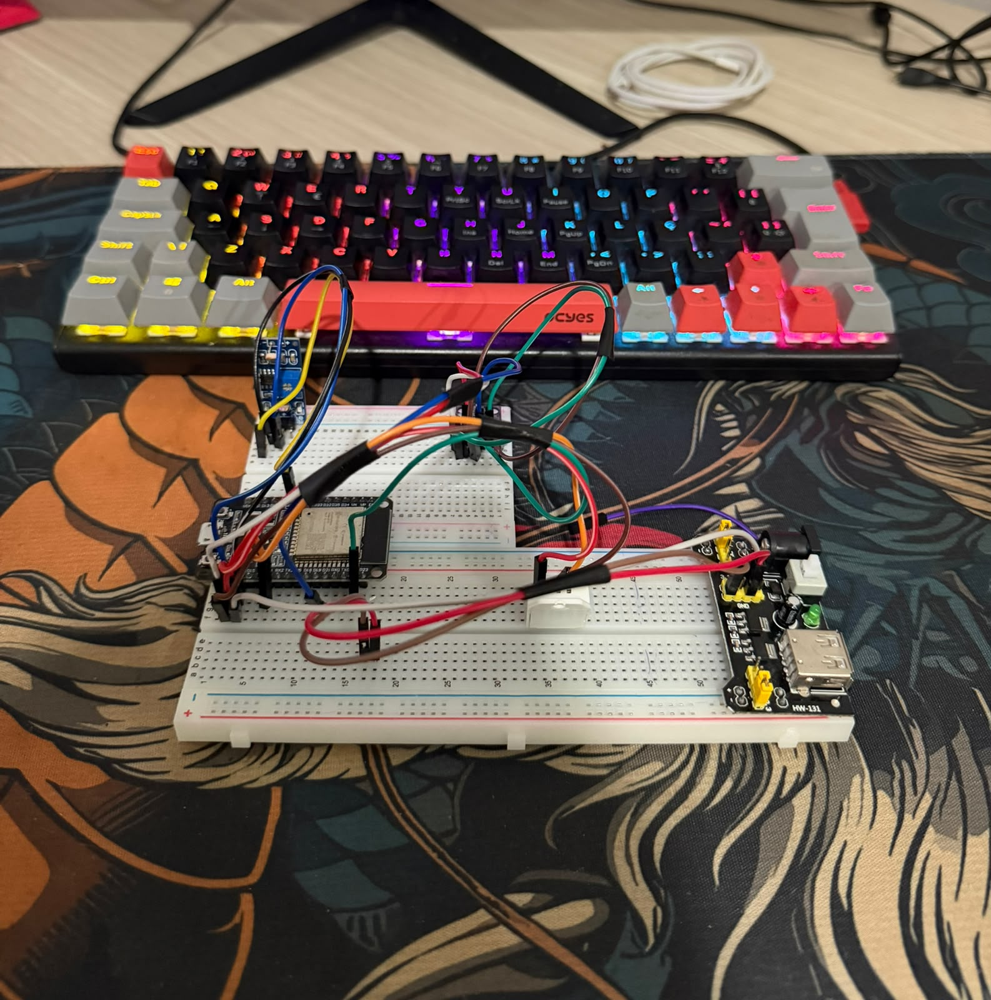
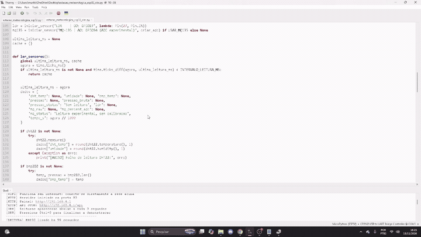
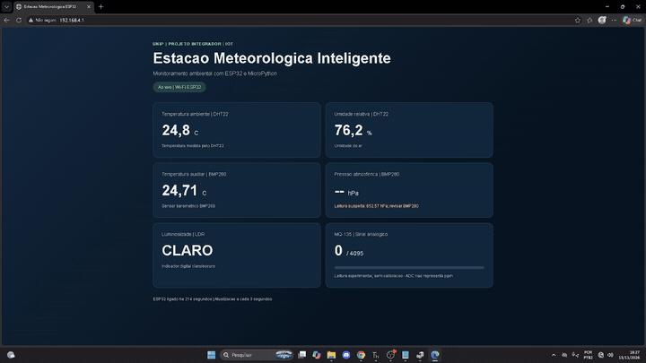
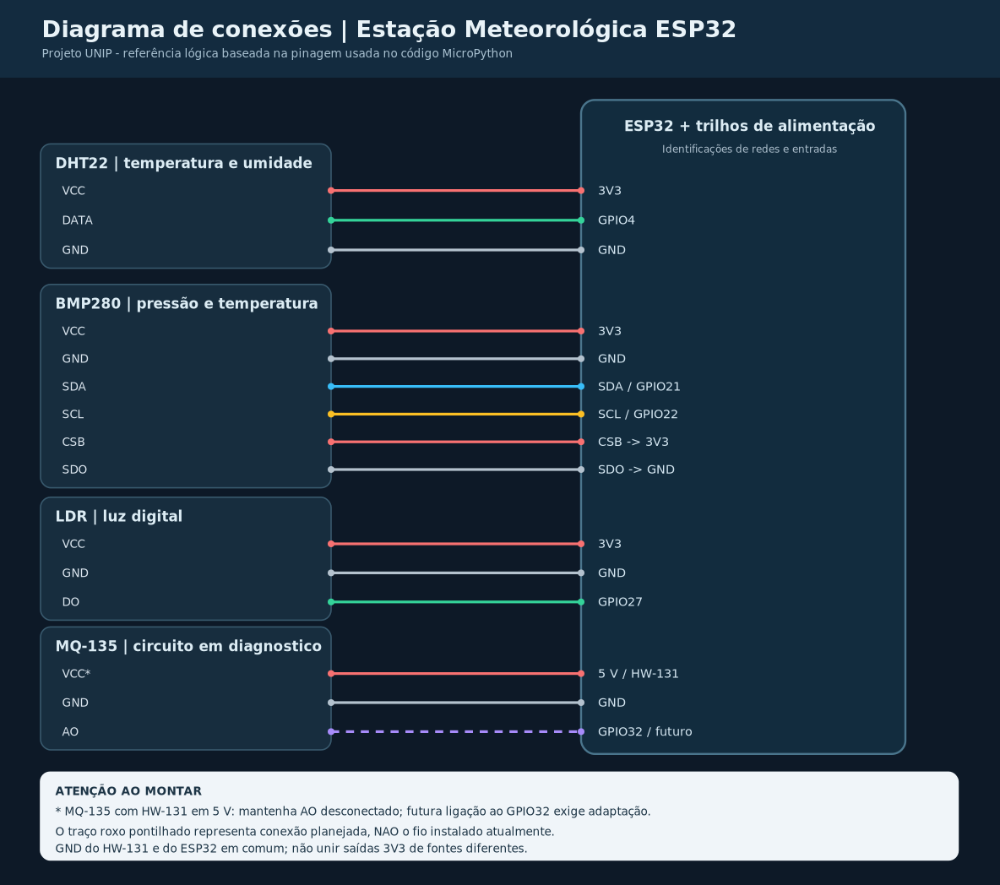

<div align="center">

# Estação Meteorológica Inteligente com ESP32

**Projeto Integrador | UNIP · Internet das Coisas (IoT)**

Monitoramento ambiental utilizando sensores conectados a um microcontrolador ESP32, com firmware em MicroPython e painel web local.



</div>

## 1. Visão geral

Este projeto acadêmico demonstra a coleta de dados ambientais e sua apresentação em uma interface web responsiva. O ESP32 lê os sensores, disponibiliza uma API HTTP em JSON e hospeda a própria interface web. O acesso ocorre pela rede Wi-Fi criada pelo dispositivo, sem depender de internet.

**Estado do MQ-135 nesta versão:** painel e API mostram `0` com origem `demonstracao`; o sensor não está validado eletricamente.

**Status do protótipo:** demonstração funcional de temperatura, umidade, luminosidade, painel local e visualização demonstrativa do MQ-135 com valor 0 identificado. A medição de pressão barométrica ainda está em diagnóstico.

### Funcionalidades

- Temperatura ambiente e umidade relativa pelo **DHT22**.
- Temperatura auxiliar e tentativa de medição de pressão pelo **BMP280**.
- Indicação digital de ambiente **claro/escuro** pelo módulo **LDR**.
- Cartão do **MQ-135** com indicação `0 / 4095` em modo de demonstração. O valor não representa uma leitura real do sensor; o código também oferece modo ADC real para uso posterior com adaptação elétrica segura.
- Servidor HTTP local e endpoints `GET /api`, `GET /api/status`, `GET /api/geometria`.
- Documentacao HTTP em `GET /docs`, adequada para captura de tela.
- Plano cartesiano 2D interativo com vetor, distancia e angulo.
- Mockup de acesso do cidadao, demonstrativo e sem geolocalizacao real.
- Dashboard responsivo atualizado a cada **3 segundos**.
- Logs das leituras na Shell do **Thonny**, úteis para testes e apresentação.

## 2. Protótipo e demonstrações

### Montagem real



### Execução no Thonny



### Dashboard atualizado e indicadores


### GIF do dashboard no navegador



> Os GIFs acima foram extraídos de uma gravação real do projeto. O vídeo da **montagem física** não faz parte desta versão do repositório e poderá ser acrescentado posteriormente.

## 3. Tecnologias e arquitetura

| Camada | Tecnologias | Responsabilidade |
| --- | --- | --- |
| Hardware | ESP32, DHT22, BMP280, LDR, MQ-135 | Aquisição de sinais e montagem experimental |
| Firmware / servidor embarcado | MicroPython | Inicialização, leitura, processamento, Wi-Fi e rotas HTTP |
| Comunicação | Wi-Fi AP + HTTP + JSON | Entrega de informações ao navegador |
| Frontend | HTML5, CSS3 e JavaScript puro | Dashboard e atualização dos valores |
| Desenvolvimento | Thonny | Edição, envio do firmware e acompanhamento dos logs |

```text
Sensores DHT22 / BMP280 / LDR + MQ-135 (em diagnostico)
                  |
                  v
            ESP32 (MicroPython)
                  |
        +---------+---------+
        |                   |
  HTTP GET /            HTTP GET /api
        |                   |
  HTML + CSS + JS         Dados JSON
        |                   |
        +---------+---------+
                  |
             Navegador
       Wi-Fi: Estacao-ESP32
```

**Observação:** nesta versão, o servidor e o frontend estão embarcados no ESP32. Não existe backend Flask/FastAPI separado, banco de dados remoto ou publicação pública na internet.

## 4. Componentes

| Componente | Quantidade | Utilização |
| --- | :---: | --- |
| Placa ESP32 | 1 | Microcontrolador e Wi-Fi |
| DHT22 | 1 | Temperatura e umidade |
| BMP280 | 1 | Temperatura e pressão barométrica |
| Módulo LDR (saída digital DO) | 1 | Luminosidade digital |
| Módulo MQ-135 | 1 | Presente na montagem; sinal AO ainda em diagnóstico |
| Protoboard e jumpers | Conforme montagem | Interconexão dos componentes |
| Módulo de alimentação HW-131 | 1 | Alimentação da montagem, conforme configuração utilizada |
| Cabo USB de dados | 1 | ESP32 para Thonny / gravação |

## 5. Diagrama de conexões e esquema eletrônico



- [Versão vetorial editável (SVG)](docs/esquematico/diagrama-conexoes.svg)
- [Imagem PNG do diagrama](docs/esquematico/diagrama-conexoes.png)

O desenho é um **diagrama lógico de conexões**, baseado na pinagem configurada no firmware e nos testes registrados. Ele não representa a posição física exata de cada jumper na protoboard. Para uma documentação elétrica definitiva, a alimentação e os jumpers precisam ser conferidos na montagem real.

### Mapeamento dos pinos

| Sensor | Terminal | Conexão / rede |
| --- | --- | --- |
| DHT22 | VCC / DATA / GND | 3V3 / GPIO4 / GND |
| BMP280 | VCC / GND | 3V3 / GND |
| BMP280 | SDA / SCL | GPIO21 / GPIO22 |
| BMP280 | CSB / SDO | 3V3 / GND (endereço I2C `0x76` na montagem testada) |
| LDR | VCC / GND / DO | 3V3 / GND / GPIO27 |
| MQ-135 | GND / AO | GND comum / AO desconectado no modo demonstração; futuro GPIO32 com adaptação de tensão |
| MQ-135 | VCC | HW-131 5 V nominal, com AO desconectado do ESP32 |

**Situação atual do MQ-135:** o módulo pode receber alimentação nominal de **5 V pelo HW-131**, com **GND compartilhado** ao ESP32, mas o fio **AO fica desconectado** enquanto não houver adaptação do sinal. No modo padrão `MQ_MODO = 'demonstracao'`, o cartão e a API exibem **0** com o estado **'Demonstracao: 0 ADC, sem sinal AO validado'**. É um exemplo de comportamento da interface, não uma medição real de gases. O GPIO32 foi validado separadamente com teste de 3,3 V (ADC 4095).

**Modo ADC real (futuro):** depois de garantir uma saída AO de no máximo 3,3 V e validar o circuito, ligue o sinal adaptado ao **GPIO32** e configure `MQ_MODO = 'adc'`. Mesmo nesse modo, a leitura é bruta e não constitui medição calibrada de ppm.

**Cuidados elétricos:**

- As entradas do ESP32 **não são tolerantes a 5 V**. A saída analógica `AO` de um MQ-135 alimentado a 5 V não deve ser ligada diretamente ao GPIO32: é necessário adaptar o nível de tensão.
- O MQ-135 normalmente requer 5 V no aquecedor. A leitura zero em modo demonstracao **nao e uma amostra ADC real**; testes anteriores em 3,3 V nao comprovaram medicao util. Nao atribua ppm ou qualidade do ar a esse valor.
- Os pontos 3V3 e GND do esquema indicam redes compartilhadas; **não conecte em paralelo saídas de dois reguladores**. Verifique a posição dos jumpers do HW-131 e a tensão medida no trilho da protoboard.
- Se o DHT22 utilizado for uma versão sem resistor pull-up integrado, um resistor externo normalmente é necessário na linha de dados; a montagem demonstrada foi testada com o pull-up interno do firmware.

## 6. Instalação e reprodução

### Pré-requisitos

1. ESP32 compatível com MicroPython e cabo USB de dados.
2. [Thonny IDE](https://thonny.org/) instalado no computador.
3. Firmware [MicroPython para ESP32](https://micropython.org/download/esp32/) instalado na placa.
4. Driver USB/serial do ESP32, se necessário para a porta COM aparecer.
5. Componentes montados conforme o mapeamento acima, respeitando os limites elétricos.

### Passo 1 — Obter o projeto

Baixe o repositório em **Code > Download ZIP** no GitHub e descompacte, ou use `git clone` depois que o repositório for publicado.

### Passo 2 — Selecionar o ESP32 no Thonny

1. Conecte o ESP32 por USB.
2. No Thonny, abra **Ferramentas > Opções > Interpretador**.
3. Selecione **MicroPython (ESP32)** e a porta COM correspondente.
4. Se ainda não houver MicroPython na placa, siga o procedimento de instalação da versão compatível com o dispositivo.

### Passo 3 — Abrir o código

Abra [`codigo/main.py`](codigo/main.py) no Thonny. Ajuste, se necessário, a configuração no início do arquivo:

```python
WIFI_NOME = 'Estacao-ESP32'
WIFI_SENHA = 'Estacao2026'
INTERVALO_LEITURA_MS = 3000
MQ_MODO = 'demonstracao'
MQ_GPIO = 32
```

> Mantenha `MQ_MODO = 'demonstracao'` enquanto o AO estiver desconectado. Somente use `MQ_MODO = 'adc'` depois de garantir um sinal de no máximo 3,3 V no GPIO32.

### Passo 4 — Executar

- Pressione **F5** no Thonny para testar e acompanhar as leituras na Shell.
- Para ligar automaticamente quando a placa iniciar, salve o mesmo código **no sistema de arquivos do ESP32** com o nome `main.py`. Não basta salvar `main.py` somente no computador.
- A Shell deverá indicar a rede Wi-Fi, o IP do servidor HTTP e as leituras dos sensores.

### Passo 5 — Abrir o dashboard

1. Conecte seu notebook ou celular à rede Wi-Fi `Estacao-ESP32`.
2. Use a senha demonstrativa `Estacao2026`.
3. No navegador, abra **http://192.168.4.1**.
4. Os cartões devem atualizar automaticamente em intervalos de aproximadamente 3 segundos.

> Por ser uma rede de laboratório demonstrativa, a senha presente no código e neste README é pública. Altere-a antes de reutilizar o firmware fora da demonstração acadêmica.

## 7. API local

O ESP32 oferece rotas HTTP documentadas na propria placa. Para registrar a API, abra `http://192.168.4.1/docs` e faca uma captura de tela:

| Método | Caminho | Retorno |
| --- | --- | --- |
| GET | `/` | Página do dashboard (HTML, CSS e JavaScript) |
| GET | `/api` | JSON com as últimas leituras dos sensores |
| GET | `/api/status` | Estado e tempo de atividade do ESP32 |
| GET | `/api/geometria?x=30&y=40` | Vetor posicao, distancia e angulo em plano 2D |
| GET | `/docs` | Documentacao da API com exemplo JSON atualizado |

Exemplo **ilustrativo** do formato de resposta (os números não representam novas medições):

```json
{
  "versao_api": "1.2",
  "estacao": {"id": "ESP32-01", "x_m": 0.0, "y_m": 0.0, "referencia": "plano cartesiano local didatico"},
  "dht_temp": 24.7,
  "umidade": 76.2,
  "bmp_temp": 24.74,
  "pressao": null,
  "pressao_bruta": 852.8,
  "pressao_status": "Leitura suspeita: revisar BMP280",
  "ldr": "CLARO",
  "mq_raw": 0,
  "mq_percent_adc": 0.0,
  "mq_origem": "demonstracao",
  "mq_sinal_detectado": false,
  "mq_status": "Demonstracao: 0 ADC, sem sinal AO validado",
  "tempo_s": 208,
  "intervalo_atualizacao_s": 3
}
```

O JavaScript usa `fetch('/api')` e atualiza os cartões. O valor `mq_raw = 0` é exibido no modo de demonstração com uma indicação explícita da sua origem; não se trata de uma medição inventada ou apresentada como real.

## 8. Interface planejada para consulta do cidadao e geometria analitica

O sistema inclui um **dashboard com indicadores em tempo real**, acessivel na rede Wi-Fi local criada pelo ESP32. A interface tem a secao **Mapa cartesiano 2D**, na qual o visitante escolhe ou clica em um ponto P = (x, y) e consulta a distancia relativa a estacao de referencia S = (0, 0).

- Vetor posicao: **v = P - S = (x - 0, y - 0)**.
- Distancia euclidiana: **d = sqrt((x - 0)^2 + (y - 0)^2)**.
- Angulo de orientacao: **theta = atan2(y - 0, x - 0)** (convertido para graus).
- Exemplo didatico: P = (30, 40) fornece v = (30, 40) e d = 50 unidades de metro na escala ilustrativa.

> **Nao e uma localizacao real.** As coordenadas sao de um plano cartesiano arbitrario utilizado no exercicio de geometria. O prototipo nao tem GPS, geocodificacao nem mapa de ruas. O site tambem nao esta publicado na internet: o "acesso do cidadao" atualmente depende da conexao local ao Wi-Fi `Estacao-ESP32`.

### Mockup da interface

- [Abrir mockup HTML interativo, com dados de exemplo](docs/mockup-cidadao.html) (abra no navegador para capturar a tela)
- [Guia para capturar as telas da API e do mapa](docs/GUIA_EVIDENCIAS_API_MAPA.md)

## 9. Testes e limitações

| Funcionalidade | Evidência / situação |
| --- | --- |
| Leitura de temperatura e umidade (DHT22) | Observada no dashboard enviado |
| Temperatura auxiliar (BMP280) | Observada no dashboard enviado |
| Pressão (BMP280) | Valor sinalizado como suspeito; não validado |
| Detecção de luminosidade (LDR) | Apresentou estado `CLARO` no dashboard |
| MQ-135 | GPIO32 validado separadamente; sensor sem sinal AO validado. Painel exibe zero demonstrativo identificado |
| Rede Wi-Fi e dashboard | Interface local registrada em vídeo e captura de tela |

A aplicação é um **protótipo acadêmico**, não uma estação meteorológica homologada ou instrumento de medição calibrado. Não há persistência de leituras em banco de dados nesta versão.

## 10. Organização do repositório

```text
estacao-meteorologica-esp32/
├── README.md
├── codigo/
│   └── main.py
├── docs/
│   ├── esquematico/
│   │   ├── diagrama-conexoes.png
│   │   └── diagrama-conexoes.svg
│   ├── GUIA_EVIDENCIAS_API_MAPA.md
│   ├── mockup-cidadao.html
│   ├── gifs/
│   │   ├── backend-thonny.gif
│   │   └── interface-web.gif
│   └── imagens/
│       ├── dashboard-final.png
│       ├── dashboard-real.jpg
│       └── prototipo-montado.jpg
└── .gitignore
```

## 11. Equipe

- **Matheus Borges Sampaio**
- **Otávio Miguel Santos Castro**
- **Letícia Rebeca de Oliveira Pereira**
- **Amanda Silva de Jesus**

## 12. Referências

- [MicroPython — documentação oficial para ESP32](https://docs.micropython.org/en/latest/esp32/tutorial/intro.html)
- [MicroPython — firmware para ESP32](https://micropython.org/download/esp32/)
- [Thonny — site oficial](https://thonny.org/)
- [Espressif — documentação técnica do ESP32](https://docs.espressif.com/projects/esp-idf/en/stable/esp32/)
- [Bosch Sensortec — BMP280](https://www.bosch-sensortec.com/products/environmental-sensors/pressure-sensors/bmp280/)

---

**Projeto acadêmico UNIP — Estação Meteorológica Inteligente com ESP32.**
